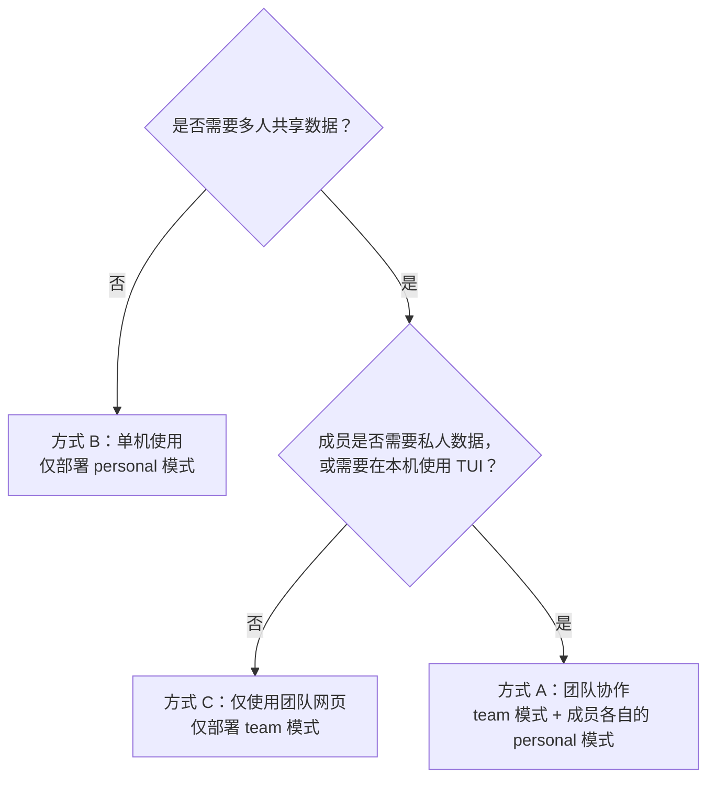
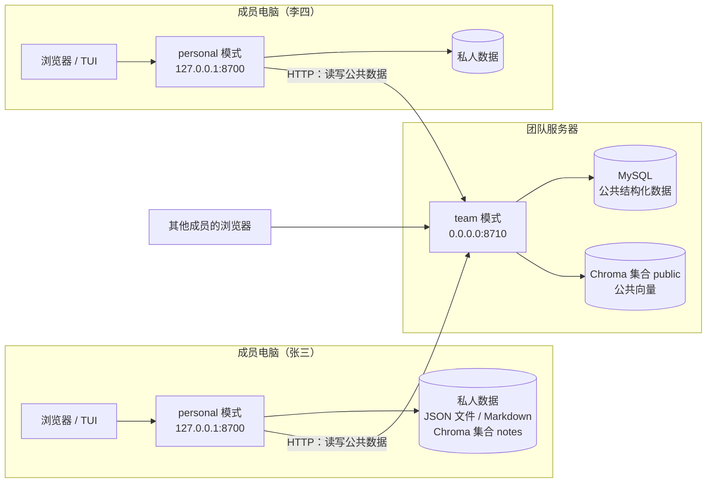
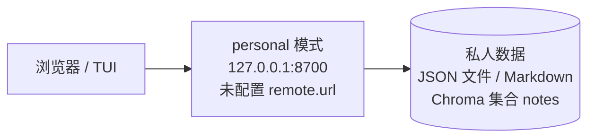
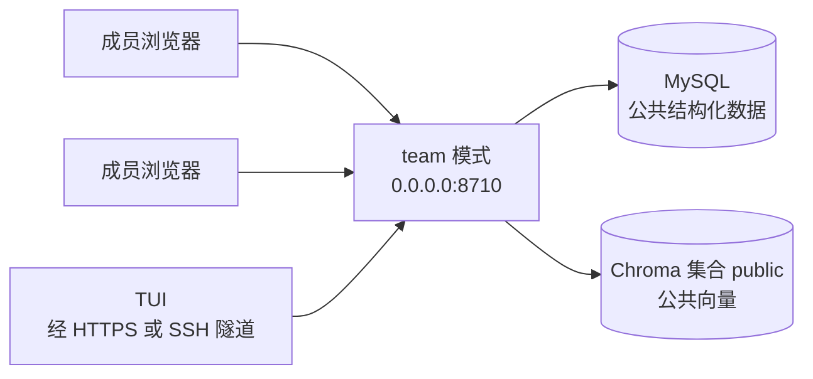
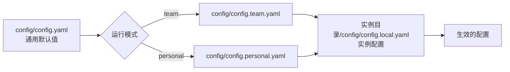

# Polaris（V2） — 个人&团队效率 AI Agent

> 你的 AI 秘书：管日程、记待办、搜笔记、联网查资料、看图说话、语音合成，定时提醒 + 心跳任务主动推送到飞书或 QQ。

基于 **LangGraph + ReAct** 构建，自然语言驱动日程、待办、笔记、搜索、语音合成。支持图片理解（多模态），发送图片即可识别内容。定时提醒 + 心跳任务周期性执行自定义提示词，结果通过 YAML 配置的多通道插件推送到消息平台。

Polaris（V2）版本是基于 Polaris（V1）： https://github.com/yan-kang/polaris 改版，增加功能：
- TUI：一个简单实用的terminal ui。
- team模式：团队合作模式，多人共同管理日程、待办。
- personal模式：V1功能。personal模式既可以和team模式一起使用，也可以分开使用。具体关系见：3. [部署方式](#3-部署方式)

---

## 目录

1. [功能概览](#1-功能概览)
2. [运行模式](#2-运行模式)
3. [部署方式](#3-部署方式)
4. [安装](#4-安装)
5. [配置文件](#5-配置文件)
6. [team 模式配置](#6-team-模式配置)
7. [personal 模式配置](#7-personal-模式配置)
8. [TUI 配置](#8-tui-配置)
9. [服务管理](#9-服务管理)
10. [系统命令](#10-系统命令)
11. [已知限制](#11-已知限制)
12. [故障排查](#12-故障排查)
13. [技术架构](#13-技术架构)
14. [开发须知](#14-开发须知)
15. [技术栈](#15-技术栈)

> 文中的 IP 地址、账号、密码、服务名称均为示例，请替换为实际值；命令均在项目根目录执行。

---

## 1. 功能概览

**团队与个人两种运行模式。** team 模式集中保存公共数据，供团队成员共享；personal 模式部署在成员各自的电脑上，管理私人数据，并通过 HTTP 读写 team 模式的公共数据。数据逐条标注【公共】/【私人】。详见 [运行模式](#2-运行模式)。

**定时提醒，主动推送。** 到点自动推送到你所在的渠道，含企业微信群、QQ、飞书；也可以通过接口、网页或 AI 主动发送通知（见 [9.6](#96-通知提醒转发与主动发送)）。支持一次性/周期性重复，日程创建自动关联提前 15 分钟提醒，服务重启后自动恢复。

```
用户："明天上午 9 点提醒我开会"
→ 创建提醒 → SchedulerDomain 调度 → 到点推送飞书/QQ

用户："帮我建个下午 3 点的日程"
→ 创建日程 → 自动关联 14:45 的提前提醒
```

**9 个内置工具，插件化自动发现。** 每个工具独立子目录，`ToolRegistry` 启动时扫描注册，新增工具只需创建目录和实现 `create_default()` 工厂函数。

| 工具 | 能力 |
|------|------|
| calendar | 日程增删改查 + 提醒自动关联 |
| todos | 待办管理，支持优先级、截止日期 |
| notes | 笔记管理 + RAG 语义搜索（ChromaDB） |
| reminder | 定时提醒，支持暂停/恢复/周期重复 |
| web_search | 联网搜索（Tavily API） |
| persona | 会话独立人格（名称/身份/性格/称呼） |
| rag | 笔记内容语义检索 |
| voice | MiMo TTS 语音合成，支持预置音色、音频标签、自然语言风格控制 |
| notify | 主动发送通知到企业微信群、QQ、飞书（预先配置的目标） |

**多通道，插件配置驱动。** 飞书 WebSocket Bot、QQ botpy SDK——所有通道共享会话记忆。新增通道只需写实现 + YAML 配置，不动框架代码。超长消息按段落/句子边界智能分段。Admin Web UI 由 FastAPI 直接托管。

**会话独立人格。** 不同会话可以是不同角色——诸葛亮、哈利波特、或一个默认助手。人格持久化存储，切换会话即切换角色。

**消息重试与编辑。** hover 用户消息可重新生成或修改后重新触发，SSE 流式输出，前后端完整支持。

**心跳定时任务。** 可配置的间隔触发机制，读取提示词文件自动调用 LLM 处理，结果推送到绑定 channel。适合定时汇报、每日总结等场景。

**Token 预算感知的上下文压缩。** 基于 tiktoken 精确计数，超出阈值时自动摘要压缩（LLM 摘要层 + 最近消息层），重启无损恢复。

**LLM 提示词缓存优化。** 将当前时间戳附加到用户消息末尾，system prompt 完全固定，最大化 prompt cache 命中率。支持 `/cache` 命令实时查看会话级缓存统计。

**多模态图片理解。** 支持发送图片，AI 自动识别内容并回复。飞书和 QQ 通道均支持图片消息解析。

**语音合成。** 集成 MiMo TTS，支持 8 种预置音色（中文/英文）、音频标签情绪控制、自然语言风格描述。Web 端点击播放，QQ 通道语音条发送。

---

## 2. 运行模式

Polaris 有两种运行模式，二者的关系类似 Git 的远程仓库与本地仓库：

| | team 模式 | personal 模式（默认） |
|---|---|---|
| 部署位置 | 团队共用的服务器，每个团队部署一个 | 成员各自的电脑 |
| 数据 | 仅公共数据（团队所有成员可见） | 私人数据（仅本人可见）和公共数据 |
| 适用对象 | 只通过浏览器使用的成员 | 需要私人数据或使用 TUI 的成员 |

personal 模式通过 team 模式读写公共数据，界面中每条数据都标注【公共】或【私人】。部署组合见 [第 3 节](#3-部署方式)，配置方法见 [第 6 节](#6-team-模式配置) 和 [第 7 节](#7-personal-模式配置)。

---

## 3. 部署方式

### 3.1 选择部署方式



### 3.2 方式 A：团队协作

在服务器上部署一个 team 模式；需要私人数据的成员在本机部署 personal 模式，并将 `remote.url` 指向 team 模式。不需要私人数据的成员可直接通过浏览器访问 team 模式。



部署步骤：

1. 在服务器上按 [第 6 节](#6-team-模式配置) 部署 team 模式；
2. 每位成员按 [第 7 节](#7-personal-模式配置) 部署 personal 模式，并配置 `remote.url`；
3. 成员通过本机浏览器（`http://127.0.0.1:8700`）或 TUI 使用 personal 模式。

### 3.3 方式 B：单机使用

仅部署 personal 模式，不配置 `remote.url`。所有数据均为私人数据，存储在本机。



### 3.4 方式 C：仅使用团队网页

仅部署 team 模式，所有成员通过浏览器访问。此方式下不存在私人数据。



---

## 4. 安装

### 4.1 环境要求

| 组件 | 要求 | 说明 |
|---|---|---|
| Python | 3.12 及以上 | 两种模式均需要 |
| Node.js | 当前 LTS 版本 | 仅用于构建网页前端 |
| 模型接口 | 兼容 OpenAI 协议 | 两种模式均需要 |
| Embedding 接口 | 兼容 OpenAI 协议 | 可选；用于笔记语义搜索和知识库 |
| MySQL | 5.6 及以上，字符集 utf8mb4 | 仅 team 模式需要 |
| 操作系统 | macOS 或 Linux | 启停脚本在 macOS 上使用 launchd 托管，在 Linux 上以后台进程运行 |

### 4.2 安装步骤

```bash
git clone <仓库地址> polaris
cd polaris
python3 -m venv venv
./venv/bin/pip install -e ".[cli]"            # cli：TUI 所需的依赖；参与开发时用 ".[dev,cli]"
(cd admin && npm install && npm run build)    # 构建网页前端，产物位于 admin/dist/
```

### 4.3 快速开始（单机使用）

以下步骤部署一个不连接 team 模式的 personal 模式（[方式 B](#33-方式-b单机使用)）。团队协作的部署见 [第 6 节](#6-team-模式配置) 和 [第 7 节](#7-personal-模式配置)。

```bash
cp config/config.local.yaml.example config/config.local.yaml
chmod 600 config/config.local.yaml
# 编辑 config/config.local.yaml：填写 llm 的 api_key、base_url、model；单机使用时删除 remote 段
./start-personal.sh
# 浏览器访问 http://127.0.0.1:8700，或执行 ./cli.sh 使用 TUI
```

---

## 5. 配置文件

### 5.1 文件组成

配置分为三层：

| 层次 | 文件 | 位置 | 纳入版本库 | 内容 |
|---|---|---|---|---|
| 通用默认值 | `config.yaml` | 项目目录 `config/` | 是 | 两种模式共用的配置项：`llm`、`embedding`、`channels`、`tools`、`voice`、`logging`、`notify`、`heartbeat`、`cleanup`、`storage`、`server` 的通用部分等 |
| 模式默认值 | `config.team.yaml` | 项目目录 `config/` | 是 | team 模式专用：`database`，以及监听地址 `0.0.0.0`、端口 `8710` |
| | `config.personal.yaml` | 项目目录 `config/` | 是 | personal 模式专用：`remote`、`visibility`，以及监听地址 `127.0.0.1`、端口 `8700` |
| 实例配置 | `config.local.yaml` | 实例目录下的 `config/` | 否 | 本实例的设置：密钥、显示名称、team 模式地址（personal）或数据库连接（team） |

实例配置的示例为 `config/config.local.yaml.example`（纳入版本库），列出了实例配置需要填写的全部配置项：两种模式共用的项在前，只属于 personal 模式（`remote`）或 team 模式（`database`）的段分别标注。personal 模式复制为 `config/config.local.yaml` 后填写；team 模式通常使用 `./start-team.sh --init` 生成，见 [6.2](#62-生成配置)。

前两层随代码更新，**不应修改**。需要调整的值一律写入 `config.local.yaml`，且只需写出与默认值不同的项。

### 5.2 加载顺序



1. 读取 `config/config.yaml`；
2. 确定运行模式，读取对应的模式默认值文件；
3. 读取实例目录下的 `config/config.local.yaml`；
4. 后读取的文件**按配置项逐项覆盖**先读取的文件，未写出的配置项保持前一层的值；
5. 修改任一文件后，须重启服务才会生效。

运行模式按以下优先级确定：

| 优先级 | 来源 | 说明 |
|---|---|---|
| 1 | 环境变量 `POLARIS_MODE` | 由 `start-team.sh` / `start-personal.sh` 为服务进程设置 |
| 2 | `config.local.yaml` 中的 `instance.mode` | 直接运行 `run.py` 时使用 |
| 3 | 默认值 `personal` | 以上均未设置时使用 |

运行模式**只能**通过以上方式设置。写在 `config/config.yaml` 中，或修改 `config/config.team.yaml`、`config/config.personal.yaml` 里的 `instance.mode`，都不会生效，启动时会给出配置提示。模式默认值文件中的 `instance.mode` 只用于标明该文件属于哪种模式。

示例：personal 模式的 `config.local.yaml` 只写了 `server.max_sessions: 50`，则最终生效的是 `server.host: "127.0.0.1"`（来自 `config.personal.yaml`）、`server.max_sessions: 50`（来自 `config.local.yaml`）、`server.rate_limit_max_requests: 30`（来自 `config.yaml`）。

> 网页的"配置"页面修改配置时，写入的是当前实例的 `config.local.yaml`。

### 5.3 配置检查

服务启动时（写入日志，前缀为`配置提示`）以及执行 `start-*.sh --check` 时，会检查 `config.local.yaml`，对以下情况给出提示。这些提示不会阻止启动：

| 情况 | 示例 | 处理建议 |
|---|---|---|
| 配置项不属于当前模式 | personal 模式的配置中有 `database` 账号密码；team 模式的配置中有 `remote.url`、`visibility` | 删除。personal 模式不应保存数据库密码 |
| 配置项已废弃 | `database.enabled`、`database.sync_interval_seconds`、`vector.memory_warn_mb`、`reminders.check_interval`、`cleanup.archive_dir`、`cleanup.archive_max_age_days`、`cleanup.calendar_retention_days`、`cleanup.todos_retention_days`、`storage.profile_file`、`admin.enabled`、`tools.calendar`、`llm.temperature`、`llm.max_tokens`、`llm.use_responses_api`、`database.table_prefix` | 删除；这些配置项已不起作用 |
| 运行模式不一致 | `POLARIS_MODE` 与 `instance.mode` 不同 | 修正 `instance.mode`。启停脚本在这种情况下会直接拒绝启动 |
| 运行模式写错了位置 | 在 `config/config.yaml` 中写了 `instance.mode`，或改了模式默认值文件里的 `instance.mode` | 改为在实例的 `config.local.yaml` 中设置 |

### 5.4 目录结构

配置与运行数据分开存放：`config/` 只放配置，`data/` 只放运行数据，`logs/` 放日志。

```text
polaris/                          项目目录，同时是 personal 模式的实例目录
├── config/
│   ├── config.yaml               通用默认值（纳入版本库）
│   ├── config.team.yaml          team 模式默认值（纳入版本库）
│   ├── config.personal.yaml      personal 模式默认值（纳入版本库）
│   ├── config.local.yaml.example 实例配置示例（纳入版本库）
│   ├── config.local.yaml         personal 模式的实例配置（不纳入版本库）
│   ├── cli.yaml.example          TUI 配置示例（纳入版本库）
│   ├── cli.yaml                  TUI 配置，可选（不纳入版本库）
│   └── heartbeat.md              心跳提示词，可选（不纳入版本库）
├── data/                         personal 模式的运行数据（不纳入版本库）
├── logs/                         personal 模式的日志（不纳入版本库）
└── instances/team/               team 模式的实例目录（不纳入版本库）
    ├── config/config.local.yaml  team 模式的实例配置
    ├── data/                     team 模式的运行数据
    └── logs/                     team 模式的日志
```

| 实例 | 实例目录 | 实例配置 | 运行数据 |
|---|---|---|---|
| personal 模式 | 项目根目录 | `config/config.local.yaml` | `data/` |
| team 模式 | `instances/team/`（可通过 `--home` 或环境变量 `POLARIS_TEAM_HOME` 修改） | `instances/team/config/config.local.yaml` | `instances/team/data/` |

- 实例目录对应环境变量 `POLARIS_HOME`；`storage.*`、`heartbeat.prompt_file` 等相对路径均相对于实例目录解析；
- 默认值文件（`config.yaml`、`config.<模式>.yaml`）始终从项目目录的 `config/` 读取，由所有实例共用；
- 两个实例的目录相互独立，因此可以在同一台机器上同时运行。

各类数据的存放位置：

| 数据类型 | team 模式 | personal 模式 |
|---|---|---|
| 待办、日程、提醒 | MySQL：`todos`、`calendar_events`、`reminders` | 私人：`data/todos.json`、`data/calendar.json`、`data/reminders.json`；公共：存储于 team 模式 |
| 笔记 | 正文：MySQL `notes`；向量：本机 Chroma，集合 `public` | 私人：`data/notes/*.md`，向量在本机 Chroma 集合 `notes`；公共：存储于 team 模式 |
| 知识库文档 | 文档记录：MySQL `knowledge_documents`；向量：本机 Chroma，集合 `public` | 私人：`data/knowledge_meta.json`，向量在本机 Chroma 集合 `notes`；公共：存储于 team 模式 |
| 会话记录、定时任务 | `instances/team/data/` | `data/` |

知识库只保存解析后的文本向量和文档记录，不保存上传的原始文件。

### 5.5 从旧版本升级

旧版本把配置和运行数据都放在 `data/` 下。升级后请按下表移动文件：

| 旧位置 | 新位置 |
|---|---|
| `data/config.local.yaml` | `config/config.local.yaml` |
| `instances/team/data/config.local.yaml` | `instances/team/config/config.local.yaml` |
| `data/heartbeat.md` | `config/heartbeat.md` |
| `data/cli/config.toml` | `config/cli.yaml`（格式由 TOML 改为 YAML，需按 [8.2](#82-配置文件) 重写） |

新位置没有文件时，服务仍会读取旧位置的 `config.local.yaml`，并给出迁移提示；`heartbeat.md` 和 TUI 配置不会读取旧位置，必须移动。

### 5.6 配置项参考

下表中"默认值位置"一列指出默认值所在的文件；"适用模式"一列标注该配置项在哪种模式下生效，出现在另一种模式的 `config.local.yaml` 中时会给出提示（见 [5.3](#53-配置检查)）。

**instance：运行模式**

| 配置项 | 类型 | 默认值 | 默认值位置 | 适用模式 | 说明 |
|---|---|---|---|---|---|
| `instance.mode` | 字符串 | `personal` | —（只能写在 `config.local.yaml`） | 全部 | `team` 或 `personal`，决定加载哪个模式默认值文件（优先级见 [5.2](#52-加载顺序)）。其他取值按 `personal` 处理，并给出配置提示 |
| `instance.name` | 字符串 | `Polaris` | `config.yaml` | 全部 | 显示名称，出现在网页、TUI 和诊断信息中，用于区分不同的服务 |

**remote：team 模式地址**

| 配置项 | 类型 | 默认值 | 默认值位置 | 适用模式 | 说明 |
|---|---|---|---|---|---|
| `remote.url` | 字符串 | 空 | `config.personal.yaml` | personal | team 模式地址，例如 `http://10.0.0.8:8710`。为空时只有私人数据 |
| `remote.timeout` | 数值（秒） | `10` | `config.personal.yaml` | personal | 请求 team 模式的超时时间。超时后本次请求按"team 模式不可用"处理 |

**database：公共数据库**

| 配置项 | 类型 | 默认值 | 默认值位置 | 适用模式 | 说明 |
|---|---|---|---|---|---|
| `database.host` | 字符串 | 空 | `config.team.yaml` | team | MySQL 地址。为空时 `start-team.sh` 拒绝启动 |
| `database.port` | 整数 | `3306` | `config.team.yaml` | team | MySQL 端口 |
| `database.name` | 字符串 | 空 | `config.team.yaml` | team | 数据库名 |
| `database.user` | 字符串 | 空 | `config.team.yaml` | team | 用户名 |
| `database.password` | 字符串 | 空 | `config.team.yaml` | team | 密码。只写在 `config.local.yaml` 中 |
| `database.connect_timeout` | 整数（秒） | `5` | `config.team.yaml` | team | 连接超时 |
| `database.read_timeout` | 整数（秒） | `15` | `config.team.yaml` | team | 读取超时 |

**visibility、sync：数据范围与同步**

| 配置项 | 类型 | 默认值 | 默认值位置 | 适用模式 | 说明 |
|---|---|---|---|---|---|
| `visibility.default_scope` | 字符串 | `public` | `config.personal.yaml` | personal | 未指定范围时新数据的范围：`public` 或 `private`。未配置 `remote.url` 时固定为 `private`；team 模式固定为 `public` |
| `sync.interval_seconds` | 数值（秒） | `60` | `config.yaml` | 全部 | 拉取公共提醒并更新本地调度的间隔 |

**server：HTTP 服务**

| 配置项 | 类型 | 默认值 | 默认值位置 | 适用模式 | 说明 |
|---|---|---|---|---|---|
| `server.host` | 字符串 | team：`0.0.0.0`；personal：`127.0.0.1` | 模式默认值 | 全部 | 监听地址。`start-personal.sh` 固定使用 `127.0.0.1` |
| `server.port` | 整数 | team：`8710`；personal：`8700` | 模式默认值 | 全部 | 监听端口，由启停脚本读取；也可用 `--port` 临时指定 |
| `server.admin_token` | 字符串 | 空 | `config.yaml` | 全部 | 接口访问令牌。**team 模式下必须为空**，原因见 [第 11 节](#11-已知限制) |
| `server.max_sessions` | 整数 | `100` | `config.yaml` | 全部 | 会话数量上限 |

**llm、embedding：模型接口**

| 配置项 | 类型 | 默认值 | 默认值位置 | 适用模式 | 说明 |
|---|---|---|---|---|---|
| `llm.api_key` | 字符串 | 空 | `config.yaml` | 全部 | 必填 |
| `llm.base_url` | 字符串 | `https://api.openai.com/v1` | `config.yaml` | 全部 | 必填 |
| `llm.model` | 字符串 | `gpt-4o` | `config.yaml` | 全部 | 必填 |
| `embedding.api_key` | 字符串 | 空 | `config.yaml` | 全部 | 可选。未配置时笔记搜索退化为关键词匹配，且无法上传知识库文档 |
| `embedding.base_url` | 字符串 | 空 | `config.yaml` | 全部 | Embedding 接口的根路径，例如 `https://example.com/v1`。**不要带 `/embeddings`**，调用时会自动拼接 |
| `embedding.model` | 字符串 | `netease-youdao/bce-embedding-base_v1` | `config.yaml` | 全部 | Embedding 模型 |

`notify.*` 见 [9.6](#96-通知提醒转发与主动发送)。其余配置项（`channels`、`tools`、`voice`、`logging`、`heartbeat`、`cleanup`、`storage`）与运行模式无关，含义见 `config/config.yaml` 中的注释。`llm.temperature`、`llm.max_tokens` 目前不可配置：对话固定使用 temperature 0.3，输出长度使用模型默认值。

### 5.7 文件权限

`config.local.yaml` 中包含模型密钥和数据库密码，应满足以下要求：

- 文件权限设为 `600`：`chmod 600 config/config.local.yaml`；
- 不得提交到版本库（`config/config.local.yaml`、`config/cli.yaml`、`data/`、`instances/` 已在 `.gitignore` 中）；
- personal 模式不需要数据库配置，**不应将 MySQL 账号分发给成员**。

---

## 6. team 模式配置

### 6.1 前置条件：准备 MySQL

建议为 Polaris 创建专用数据库：

```sql
CREATE DATABASE polaris DEFAULT CHARACTER SET utf8mb4 COLLATE utf8mb4_unicode_ci;
CREATE USER 'polaris'@'%' IDENTIFIED BY '<密码>';
GRANT SELECT, INSERT, UPDATE, DELETE, CREATE ON polaris.* TO 'polaris'@'%';
```

- team 模式首次使用数据库时自动执行 `CREATE TABLE IF NOT EXISTS`，创建 5 张表：`todos`、`calendar_events`、`reminders`、`notes`、`knowledge_documents`。不会修改或删除已有的表；
- 建表语句定义在 `src/core/db/schema.py`，如需由 DBA 手工建表可参考该文件；
- 表名不加前缀，**请为 Polaris 单独建库**，不要与其他项目共用一个库，以免表名冲突；
- 连接时会强制使用 `utf8mb4` 字符集和严格 SQL 模式，超长数据会报错，不会被静默截断。

### 6.2 生成配置

```bash
./start-team.sh --init
```

此命令执行以下操作：

1. 创建 `instances/team/config/config.local.yaml`，权限 `600`；
2. 如果项目的 `config/config.local.yaml` 中已有 `llm`、`embedding`、`database` 配置，则复制到新文件中。输出只列出复制了哪几段，不显示内容；
3. 写入 `instance.mode: team`。监听地址、端口等 team 模式默认值已在 `config/config.team.yaml` 中，不再写入实例配置。

目标文件已存在时，命令不会覆盖并直接退出。如需使用其他实例目录，请指定 `--home <目录>`，之后启停时也须带上相同的 `--home`。

### 6.3 配置示例

生成的文件内容与下例类似（各配置项说明见 `config/config.local.yaml.example`），请按实际情况修改：

```yaml
instance:
  mode: team                # 必须明确写出；start-team.sh 会核对
  name: "产品组团队服务"

llm:
  api_key: "<模型密钥>"
  base_url: "https://<模型接口>/v1"
  model: "<模型名称>"

embedding:
  api_key: "<Embedding 密钥>"
  base_url: "https://<Embedding 接口>/v1"
  model: "<Embedding 模型>"

database:
  host: "10.0.0.20"
  port: 3306
  name: "polaris"
  user: "polaris"
  password: "<密码>"
```

- 监听地址 `0.0.0.0`、端口 `8710` 来自 `config/config.team.yaml`，需要修改时在本文件中写 `server.host` / `server.port`；
- `server.admin_token` 必须保持为空；
- team 模式不使用 `remote` 和 `visibility` 配置。

### 6.4 启动与验证

```bash
./start-team.sh --check     # 检查配置并试连数据库，不启动
./start-team.sh             # 启动
```

启动成功后按以下方式验证：

| 检查项 | 方法 | 预期结果 |
|---|---|---|
| 服务模式 | `curl http://10.0.0.8:8710/api/instance` | 返回 `"mode":"team"`、`"public":true`、`"private":false` |
| 数据库连接 | 查看 `instances/team/logs/polaris.log` | 包含 `公共库已连接：…/polaris` |
| 网页 | 浏览器访问 `http://10.0.0.8:8710/` | 侧边栏顶部显示"团队服务 · 产品组团队服务" |
| 网络 | 在成员电脑上执行上述 `curl` | 返回相同结果。如失败，请检查服务器防火墙是否放行 8710 端口 |

### 6.5 生产环境托管

在 Linux 上，`start-team.sh` 以后台进程方式启动服务，系统重启后不会自动恢复。生产环境建议使用 systemd 托管。示例 `/etc/systemd/system/polaris-team.service`（路径按实际修改）：

```ini
[Unit]
Description=Polaris Team Service
After=network.target

[Service]
WorkingDirectory=/opt/polaris
Environment=POLARIS_HOME=/opt/polaris/instances/team
Environment=POLARIS_MODE=team
Environment=TZ=Asia/Shanghai
ExecStart=/opt/polaris/venv/bin/python -u run.py --home /opt/polaris/instances/team --host 0.0.0.0 --port 8710
Restart=on-failure

[Install]
WantedBy=multi-user.target
```

```bash
sudo systemctl daemon-reload
sudo systemctl enable --now polaris-team
```

使用 systemd 托管后，请通过 `systemctl` 启停，不要再使用 `start-team.sh` / `stop-team.sh`。

> **时区要求**：提醒时间按服务所在机器的本地时间存储和触发。team 模式和所有 personal 模式必须使用相同的时区，否则同一条公共提醒会在不同时刻触发。启停脚本使用当前终端的 `TZ`；未设置时使用 `Asia/Shanghai`。

### 6.6 备份

| 对象 | 位置 | 内容 | 丢失的影响 |
|---|---|---|---|
| MySQL 数据库 | `database.name` 指定的库 | 公共待办、日程、提醒、笔记正文、知识库文档记录 | 公共数据丢失 |
| Chroma 目录 | `instances/team/data/chroma/` | 公共笔记和知识库文档的向量 | 无法语义检索。公共文档须重新上传，因为原始文件不保存 |
| 配置文件 | `instances/team/config/config.local.yaml` | team 模式配置 | 需重新配置 |
| 会话目录 | `instances/team/data/sessions/` | team 模式网页上的会话记录 | 不影响业务数据 |

---

## 7. personal 模式配置

### 7.1 配置示例

编辑项目的 `config/config.local.yaml`。文件不存在时，从示例复制：

```bash
cp config/config.local.yaml.example config/config.local.yaml
chmod 600 config/config.local.yaml
```

最小配置如下：

```yaml
instance:
  mode: personal             # 可省略，默认即为 personal
  name: "张三的 Polaris"

llm:
  api_key: "<模型密钥>"
  base_url: "https://<模型接口>/v1"
  model: "<模型名称>"

remote:
  url: "http://10.0.0.8:8710"   # team 模式地址；不配置则只有私人数据
```

`remote.timeout`、`visibility.default_scope`、`sync.interval_seconds` 的默认值分别为 `10`、`public`、`60`（见 `config/config.personal.yaml` 和 `config/config.yaml`），需要修改时再写入本文件。

说明：

- personal 模式不使用 `database` 配置，也不会连接 MySQL。配置中残留 `database` 账号密码时，启动会提示删除；
- `remote.url` 只能指向 team 模式的服务。首次连接时，personal 模式会先调用对方的 `/api/instance` 确认模式；如果对方不是 team 模式（例如误填为其他成员的 personal 模式），personal 模式会拒绝连接，以免读取到他人的私人数据；
- `embedding` 只用于私人笔记和私人知识库，公共知识库使用 team 模式的 Embedding 配置。

### 7.2 启动与验证

```bash
./start-personal.sh --check     # 检查配置并试连 team 模式，不启动
./start-personal.sh             # 启动，地址 http://127.0.0.1:8700
```

| 检查项 | 方法 | 预期结果 |
|---|---|---|
| 服务模式 | `curl http://127.0.0.1:8700/api/instance` | 返回 `"mode":"personal"`、`"private":true`；配置了 `remote.url` 时 `"public":true` |
| team 模式连接 | `./cli.sh doctor` | `服务模式：个人服务 · 张三的 Polaris（私人 + 公共数据，…）` 以及 `团队服务：已连接：…` |

### 7.3 数据范围规则

| 实例状态 | 未指定范围 | 指定为公共 | 指定为私人 |
|---|---|---|---|
| personal，已配置 `remote.url` | 按 `visibility.default_scope` | 写入 team 模式 | 写入本机 |
| personal，未配置 `remote.url` | 私人 | 拒绝 | 写入本机 |
| team | 公共 | 写入 MySQL | 拒绝 |

公共提醒（含公共日程"开始前 15 分钟"的关联提醒，由 team 模式统一创建）由 team 模式和每个 personal 模式分别调度，各自推送给本服务的用户；personal 模式每 `sync.interval_seconds` 秒从 team 模式拉取一次。

对话中，模型根据用户的表述判断范围：如"私人""私有""只给我""个人的"判为私人，"公共""团队""大家"判为公共。工具输出和回答中的每条数据都带有【公共】或【私人】标签。

### 7.4 team 模式不可用时的行为

| 操作 | 行为 |
|---|---|
| 查询列表、搜索 | 仅返回私人数据，并附带失败原因 |
| 新建、修改、删除公共数据 | 失败并返回原因，不会改存为私人数据 |
| 私人数据的所有操作 | 不受影响 |
| 公共提醒 | 按最近一次成功拉取的结果继续调度；team 模式恢复后，在下一个同步周期更新 |

---

## 8. TUI 配置

TUI 只连接已在运行的服务，不会启动或停止服务。连接的服务属于哪种模式，决定了可以访问哪些数据。

### 8.1 连接目标

| 连接目标 | 命令 | 可访问的数据 |
|---|---|---|
| 本机 personal 模式 | `./cli.sh`（默认连接 `http://127.0.0.1:8700`） | 私人数据 + 公共数据 |
| 本机 team 模式 | `./cli.sh --url http://127.0.0.1:8710` | 公共数据 |
| 其他机器上的 team 模式 | 见 [8.5](#85-连接其他机器上的服务) | 公共数据 |

连接成功后：

- 欢迎页的"模式"一行显示服务类型、名称和可访问的数据范围；
- 输入框右下角显示服务标识，例如 `个人服务·张三的 Polaris`；
- `/status` 命令显示服务模式，以及 personal 模式当前能否连接 team 模式。

### 8.2 配置文件

TUI 的配置文件默认为 `config/cli.yaml`，格式与服务端配置相同（YAML）；运行状态（最近会话、输入历史）保存在 `data/cli/`。可通过 `--config` 或环境变量 `POLARIS_CLI_CONFIG` 指定其他配置文件；设置 `POLARIS_CLI_HOME` 后，配置文件（`cli.yaml`）和运行状态都放在该目录。

配置文件是可选的，不创建时全部使用默认值。需要修改时从示例复制：

```bash
cp config/cli.yaml.example config/cli.yaml
chmod 600 config/cli.yaml
```

TUI 只读取这一个文件，不读取服务端的 `config.local.yaml`，因此不会接触模型密钥。完整的配置项如下（与 `config/cli.yaml.example` 一致）：

```yaml
default_profile: local

profiles:
  local:
    url: "http://127.0.0.1:8700"
  team:
    url: "http://127.0.0.1:8710"   # 非本机地址必须使用 https，见 8.5
    # token_file: "~/.config/polaris/token"   # 服务端开启 admin_token 时使用

ui:
  theme: auto              # auto / dark / light
  color: auto              # auto / always / never
  persist_history: false   # 是否把输入历史保存到磁盘

network:
  connect_timeout: 5       # 秒
  read_timeout: 300        # 秒
```

| 配置项 | 默认值 | 说明 |
|---|---|---|
| `default_profile` | `local` | 未指定 `--profile` 时使用的连接配置 |
| `profiles.<名称>.url` | `http://127.0.0.1:8700` | 服务地址 |
| `profiles.<名称>.token_file` | 无 | 访问令牌文件，建议权限 `600` |
| `ui.theme` | `auto` | 配色 |
| `ui.color` | `auto` | 是否输出颜色 |
| `ui.persist_history` | `false` | 是否持久化输入历史 |
| `network.connect_timeout` | `5` | 连接超时（秒） |
| `network.read_timeout` | `300` | 读取超时（秒） |

使用 `./cli.sh --profile team` 切换连接配置。

### 8.3 配置优先级

同一设置从多个来源读取时，按以下优先级生效（从高到低）：

1. 命令行参数：`--url`、`--profile`、`--config`、`--token-file`、`--theme`、`--color`；
2. 环境变量：`POLARIS_URL`、`POLARIS_PROFILE`、`POLARIS_ADMIN_TOKEN`；
3. 配置文件 `config/cli.yaml`；
4. 内置默认值。

访问令牌只能通过环境变量 `POLARIS_ADMIN_TOKEN` 或令牌文件提供，不支持在命令行中直接传入，以免泄露到 shell 历史和进程列表。

### 8.4 环境变量

| 环境变量 | 作用 |
|---|---|
| `POLARIS_URL` | 服务地址 |
| `POLARIS_PROFILE` | 使用的连接配置名称 |
| `POLARIS_ADMIN_TOKEN` | 访问令牌 |
| `POLARIS_CLI_CONFIG` | 配置文件路径 |
| `POLARIS_CLI_HOME` | 将 TUI 的配置文件（`cli.yaml`）和运行状态都放在该目录；未设置时配置在 `config/cli.yaml`、状态在 `data/cli/` |

### 8.5 连接其他机器上的服务

出于安全考虑，TUI 只允许对本机地址（`127.0.0.1`、`localhost`）使用 `http`；连接其他机器必须使用 `https`，否则报错"远程地址必须使用 https"。在没有 HTTPS 的内网环境中，可以采用以下任一方式：

**方式一：SSH 端口转发**

```bash
ssh -N -L 8711:127.0.0.1:8710 user@10.0.0.8   # 保持该会话运行
./cli.sh --url http://127.0.0.1:8711
```

**方式二：HTTPS 反向代理**

在 team 模式前部署 HTTPS 反向代理（如 Nginx），TUI 连接 `https://` 地址。

> 此限制只针对 TUI。personal 模式访问 team 模式属于服务端之间的调用，可以直接使用 `http://`。

---

## 9. 服务管理

### 9.1 启停脚本

| 脚本 | 作用 | 实例目录 | 默认地址 |
|---|---|---|---|
| `start-team.sh` | 启动 team 模式 | `instances/team/` | `0.0.0.0:8710` |
| `stop-team.sh` | 停止 team 模式 | 同上 | — |
| `start-personal.sh` | 启动 personal 模式 | 项目根目录 | `127.0.0.1:8700` |
| `stop-personal.sh` | 停止 personal 模式 | 同上 | — |

### 9.2 参数

| 参数 | 适用脚本 | 作用 |
|---|---|---|
| `--check` | `start-*.sh` | 检查配置，试连数据库（team）或 team 模式（personal），不启动 |
| `--init` | `start-team.sh` | 生成 team 模式配置模板，见 [6.2](#62-生成配置) |
| `--port <端口>` | `start-*.sh` | 本次启动使用的端口，优先于 `server.port` |
| `--host <地址>` | `start-team.sh` | 本次启动的监听地址，优先于 `server.host` |
| `--home <目录>` | `start-team.sh`、`stop-team.sh` | team 模式的实例目录 |
| `--status` | `stop-*.sh` | 只查看运行状态，不停止 |

### 9.3 脚本行为

- **模式校验**：启动前核对 `config.local.yaml` 中的 `instance.mode` 与脚本是否一致，不一致时拒绝启动。team 模式的配置必须明确写出 `instance.mode: team`；personal 模式的配置可以省略；
- **加载模式默认值**：为服务进程设置环境变量 `POLARIS_MODE`，使其加载对应的模式默认值文件；
- **启动检查**：缺少必填配置时拒绝启动，例如 `llm.*`，或 team 模式的 `database.host`；
- **端口占用**：端口已被占用时拒绝启动，不会停止占用端口的进程；
- **托管方式**：macOS 上注册为 launchd 用户级服务，不加入登录自启动；其他系统上以后台进程运行。启动信息（托管方式、进程号、端口）记录在实例目录的 `logs/polaris.service.json`，停止时按记录的方式处理；
- **停止**：只发送正常退出信号，最多等待 30 秒，不强制终止进程；
- **数据安全**：启停脚本不会删除配置、数据或日志；
- **日志**：`<实例目录>/logs/polaris.log`。

### 9.4 直接使用 run.py

不使用启停脚本时，可以直接运行 `run.py`，并用 `--home` 为每个实例指定独立的实例目录，例如在同一台服务器上运行自用实例和公开试用实例：

```bash
# 自用实例（默认端口 8700）
python run.py

# 公开试用实例（端口 8800，独立数据，每IP每日50条消息）
mkdir -p /opt/polaris-demo/config
# 编辑 /opt/polaris-demo/config/config.local.yaml（API key 等）
python run.py --home /opt/polaris-demo --port 8800 --demo 50
```

不同实例的数据（会话、提醒、日程等）完全隔离。直接运行 `run.py` 时：

- 运行模式取实例 `config.local.yaml` 中的 `instance.mode`，也可以用环境变量 `POLARIS_MODE` 指定；
- 端口只由 `--port` 决定（默认 8700），**不读取** `server.port`；监听地址取 `--host`，未指定时读取 `server.host`。

### 9.5 在同一台机器上运行两种模式

两种模式的实例目录和默认端口互不冲突，可以在同一台机器上同时运行，用于试用或开发：

```bash
./start-team.sh --init                  # 首次运行：生成 team 模式配置，按 6.3 检查
./start-team.sh                         # team 模式：0.0.0.0:8710
# 在项目的 config/config.local.yaml 中设置 remote.url: "http://127.0.0.1:8710"
./start-personal.sh                     # personal 模式：127.0.0.1:8700
./cli.sh                                # 连接 personal 模式：私人数据 + 公共数据
./cli.sh --url http://127.0.0.1:8710    # 连接 team 模式：仅公共数据
```

### 9.6 通知：提醒转发与主动发送

通知目标有三类，地位相同：

| 类型 | 配置 | 说明 |
|---|---|---|
| 企业微信群机器人 | `notify.webhooks` | 群里"添加群机器人"后获得 webhook 地址；单向，只发不收 |
| QQ 私聊 | `notify.recipients`，`channel: "qq:<openid>"` | 需要启用并连上 QQ 渠道 |
| 飞书私聊、飞书群聊 | `notify.recipients`，`channel: "feishu:<open_id>"` 或 `"feishu-chat:<chat_id>"` | 需要启用并连上飞书渠道 |

通知目标有两种用途：

| 用途 | 何时发送 | 发给谁 |
|---|---|---|
| **提醒转发** | 提醒到点时自动发送（一次性提醒、周期提醒的每一次、日程"开始前 15 分钟"提醒） | 所有 `scopes` 包含该提醒范围（公共/私人）的目标 |
| **主动通知** | 通过接口、网页"通知"页面或 AI 工具发送 | 调用时按名称指定的目标，不受 `scopes` 限制 |

只能发给配置中列出的目标：接口和 AI 只能按名称选择，不能临时指定 webhook 地址或账号。

#### 配置

写在实例的 `config.local.yaml` 中。webhook 地址里的 `key` 相当于密码，不能写进入库的文件：

```yaml
notify:
  api_token: ""                    # 通知接口令牌，见下文"鉴权"
  webhooks:
    - name: 团队群                 # 目标名称，接口和 AI 按名称发送；所有目标的名称不能重复
      type: wecom
      url: "https://qyapi.weixin.qq.com/cgi-bin/webhook/send?key=<key>"
      scopes: [public]             # 转发哪些提醒：public、private；不写则都转发
  recipients:
    - name: 张三QQ
      channel: "qq:<openid>"
      scopes: [private]
    - name: 项目飞书群
      channel: "feishu-chat:<chat_id>"
```

- QQ 的 openid 只有用户先给机器人发过消息后才能获得，可以在会话列表的渠道名（`qq:<openid>`）中查到；飞书的 open_id、chat_id 同理，也可以从飞书开放平台查询；
- 修改后重启服务生效；`start-*.sh --check` 会列出生效的目标，并提示配置错误、渠道未启用等问题。

#### 主动通知的三个入口

**1. HTTP 接口（CI、脚本）**

```bash
curl -X POST http://10.0.0.8:8710/api/notify/send \
  -H "Authorization: Bearer $POLARIS_NOTIFY_TOKEN" -H "Content-Type: application/json" \
  -d '{"targets":["团队群","张三QQ"],"title":"构建失败：polaris#128","content":"main 分支测试未通过","source":"CI"}'
```

| 接口 | 说明 |
|---|---|
| `GET /api/notify/targets` | 列出目标名称、类型、`scopes`、当前是否可用及原因；不返回地址和账号 |
| `POST /api/notify/send` | 参数：`targets`（名称列表）、`title`、`content`、`source`（来源，写在消息末尾）。返回每个目标的结果：`{"results": [{"target": "团队群", "ok": true}, {"target": "张三QQ", "ok": false, "error": "…"}]}` |

返回码：`200` 已逐个尝试发送（部分失败也是 200，需看每个目标的 `ok`）；`400` 目标不存在、内容为空或过长；`401` 令牌错误；`429` 所有目标都超过频率限制。

**2. 网页"通知"页面**

侧边栏"通知"：勾选目标、填写标题和正文后发送，页面显示每个目标的结果。不可用的目标会显示原因。服务设置了 `notify.api_token` 时，页面会要求输入令牌，令牌只保存在当前浏览器中。

**3. AI 工具 `notify`**

在对话（网页、TUI、QQ、飞书）中直接要求，例如"把目前未完成的待办和今天的提醒整理一下，发到团队群和张三的 QQ"。AI 会先查询待办、提醒等数据，整理成正文，再发送，并回复每个目标的结果。

- AI 只在用户明确要求发送时才调用该工具，发送前不会再确认；
- 消息内容由 AI 根据你的要求组织。在 personal 模式下，查询结果可能同时包含【公共】和【私人】数据，系统不会自动过滤，发到群里前请在要求中说明范围（例如"只发公共的待办"）。

#### 鉴权

| `notify.api_token` | 通知接口的鉴权 |
|---|---|
| 已设置 | 请求头必须带 `Authorization: Bearer <api_token>`；此时通知接口不再要求 `server.admin_token`，CI 只需持有通知令牌 |
| 为空（默认） | 通知接口不单独鉴权，与其他接口一样只受 `server.admin_token` 约束；`admin_token` 也为空时不鉴权 |

team 模式的 `server.admin_token` 目前必须为空（见 [第 11 节](#11-已知限制) L1），因此在 team 模式上开放给 CI 使用时，建议设置 `notify.api_token`，否则能访问服务端口的人都可以调用通知接口。AI 工具在服务进程内调用，不需要令牌。

#### 限制与失败处理

| 项目 | 规则 |
|---|---|
| 频率 | 每个目标每分钟最多 20 条（与企业微信群机器人的官方上限一致），提醒转发和主动通知合计 |
| 长度 | 标题最多 200 字，正文最多 4000 字；企业微信消息超过 4096 字节时截断，QQ、飞书按渠道规则分段 |
| 格式 | 企业微信使用 markdown；QQ、飞书使用纯文本。消息末尾标注来源和服务名称（`instance.name`） |
| 失败 | 不重试。主动通知把每个目标的结果返回给调用方；提醒转发只写日志，不影响提醒原有的推送方式 |
| 日志 | 只记录目标名称；请求地址中的 `key` 会被遮盖 |

**避免重复的提醒转发**：一条公共提醒会在 team 模式和每个 personal 模式上各触发一次。多人都把公共提醒转发到同一个群时，群里会收到多条。建议 team 模式的目标用 `scopes: [public]`，personal 模式的目标用 `scopes: [private]`；personal 模式转发公共提醒时，`--check` 会给出提示。

---

## 10. 系统命令

在网页、QQ、飞书的对话中可以使用以下命令：

| 命令 | 功能 |
|------|------|
| `/new <名称>` | 创建新会话 |
| `/sessions` | 查看所有会话 |
| `/session <id\|名称>` | 切换会话 |
| `/rename <名称>` | 重命名当前会话 |
| `/status` | 会话状态（消息数、Token 用量） |
| `/cache` | LLM 缓存命中率统计 |
| `/compact` | 手动触发上下文压缩 |
| `/reset` | 重置当前会话记忆 |
| `/reload` | 热重载配置（无需重启） |
| `/cleanup` | 手动清理过期数据 |
| `/help` | 显示帮助 |

TUI 的命令与上表不同，会话管理方式与 Claude Code 一致：

| 命令 | 功能 |
|------|------|
| `/resume [名称或ID]` | 打开会话选择器，或直接恢复指定会话 |
| `/clear` | 开始新会话（旧会话保留） |
| `/rename <名称>` | 重命名当前会话 |
| `/history`、`/view` | 查看当前会话的历史消息、某次回答的详情 |
| `/todos`、`/calendar`、`/reminders` | 直接查询待办、日程、提醒，不调用模型 |
| `/status`、`/tools`、`/cache`、`/compact` | 连接与会话状态、工具列表、缓存统计、手动压缩 |
| `/theme`、`/help`、`/quit` | 切换配色、帮助、退出 |

`/reset`、`/cleanup`、`/reload` 在 TUI 中不开放，需要时请在网页上操作。

---

## 11. 已知限制

| 编号 | 限制 | 影响与建议 |
|---|---|---|
| L1 | personal 模式调用 team 模式时不携带访问令牌 | team 模式配置 `server.admin_token` 后，personal 模式会因 401 无法连接。team 模式须保持 `admin_token` 为空，并仅在内网中部署 |
| L2 | 公共数据不记录创建人，也没有权限控制 | 能访问 team 模式的人都可以修改或删除任何公共数据。多人同时修改同一条数据时，后提交的覆盖先提交的 |
| L3 | team 模式网页没有用户区分 | 所有访问者看到同一组会话，并且都能使用"配置"页面修改 team 模式的配置 |
| L4 | personal 模式不缓存公共数据 | 每次查询都实时请求 team 模式，team 模式响应慢时，查询也会相应变慢 |
| L5 | 公共提醒只推送到网页当前会话 | 不推送到 QQ、飞书等渠道 |
| L6 | 网页上没有数据范围选择 | 在网页上新建的数据使用默认范围；TUI 和对话中可以指定范围 |
| L7 | 不支持修改已有数据的范围 | 如需将私人数据改为公共数据，只能新建一条公共数据后删除原数据。升级前已有的数据不会自动迁移 |
| L8 | MySQL 连接未启用 SSL | 账号和数据以明文传输，仅应在内网中使用 |
| L9 | 知识库不保存原始文件 | Chroma 目录丢失后须重新上传文档 |
| L10 | 模型上下文窗口固定按 200K token 计算 | 会话超过 160K token 才压缩。若所用模型的上下文窗口更小（如 128K），长会话可能因超出上限而请求失败 |
| L11 | 请求不携带 `max_tokens`，也不检测输出截断 | 输出上限取决于模型服务的默认值；回答因达到上限被截断时没有提示 |
| L12 | `temperature` 不可配置 | 对话固定为 0.3、上下文压缩固定为 0；网页上"重新生成"的结果与原回答差别很小 |
| L13 | 通知能力有限 | 企业微信只支持群机器人（只能发到机器人所在的群）；QQ 只支持私聊；发送失败不重试；心跳任务的结果不会转发；AI 发送前不确认，也不会自动过滤私人数据 |

---

## 12. 故障排查

### 12.1 启动阶段

| 现象 | 可能原因 | 处理方法 |
|---|---|---|
| `缺少配置文件：…/instances/team/config/config.local.yaml` | 尚未生成 team 模式配置 | 执行 `./start-team.sh --init` |
| `配置里的 instance.mode 是 'personal'，和团队服务（team）不一致` | team 模式配置中的模式不是 `team`，或者修改的是项目的 `config/config.local.yaml` | team 模式的配置位于 `instances/team/config/config.local.yaml`，请在该文件中设置 `instance.mode: team` |
| `… 里没有写 instance.mode` | team 模式的 `config.local.yaml` 未写模式 | 写入 `instance.mode: team` |
| `没有配置 database.host` | team 模式未配置数据库 | 填写 `database` 配置 |
| `缺少默认配置：…/config.team.yaml` | 项目文件不完整 | 从版本库恢复 `config/config.yaml`、`config/config.team.yaml`、`config/config.personal.yaml` |
| `实例配置仍在旧位置 …` | 从旧版本升级后未移动配置文件 | 按 [5.5](#55-从旧版本升级) 移动文件 |
| `… 已被占用` | 端口被其他进程占用 | 使用 `--port` 或 `server.port` 更换端口，并同步修改各 personal 模式的 `remote.url` |
| `未确认服务就绪` | 服务进程启动失败 | 查看 `<实例目录>/logs/polaris.log` |
| `数据库连接失败` | 地址、端口、账号或密码错误，网络不通，或未授权 | 检查 `database` 配置，并与 DBA 确认授权 |

### 12.2 运行阶段

| 现象 | 可能原因 | 处理方法 |
|---|---|---|
| personal 模式提示`没有连接团队服务（remote.url 未配置）` | 未配置 `remote.url`，或配置位置错误 | `remote` 须为 `config.local.yaml` 的顶层配置项；修改后重启 personal 模式 |
| 提示`连不上团队服务 …（Connection refused）` | team 模式未运行、端口错误、监听地址为 `127.0.0.1`，或防火墙未放行 | 确认 team 模式正在运行、`server.host` 为 `0.0.0.0`，并检查服务器防火墙 |
| 提示`指向的不是团队服务……已拒绝连接` | `remote.url` 指向的不是 team 模式的服务 | 将 `remote.url` 改为 team 模式地址 |
| 提示`团队服务返回错误 401` | team 模式配置了 `server.admin_token` | 清空 team 模式的 `admin_token` 并重启 team 模式，见 L1 |
| 日志中出现`配置提示：…` | `config.local.yaml` 中有不属于当前模式或已废弃的配置项 | 按提示删除，见 [5.3](#53-配置检查) |
| 在 team 模式上创建私人数据被拒绝 | team 模式只保存公共数据 | 属预期行为；如需私人数据，请部署 personal 模式 |
| 语义搜索或知识库上传报 `404` | `embedding.base_url` 末尾带了 `/embeddings`，实际请求的是 `…/embeddings/embeddings` | 去掉末尾的 `/embeddings` |
| 知识库上传提示`未配置 embedding.api_key` | 保存该文档的服务未配置 Embedding | 公共文档在 team 模式上配置，私人文档在 personal 模式上配置 |
| TUI 提示`远程地址必须使用 https` | TUI 不允许对非本机地址使用 http | 见 [8.5](#85-连接其他机器上的服务) |
| 通知目标没有收到消息 | 企业微信：地址或 `key` 错误、机器不能访问外网；QQ / 飞书：渠道未启用或未连接、账号 ID 错误；提醒转发：`scopes` 不包含该提醒的范围；或超过频率限制 | 主动通知直接看返回的 `error`；提醒转发看日志中的 `提醒转发失败` 记录；执行 `start-*.sh --check` 检查配置 |
| 调用通知接口返回 401 | 设置了 `notify.api_token` 但请求未携带或携带错误；或未设置 `api_token` 而设置了 `server.admin_token` | 请求头加 `Authorization: Bearer <令牌>` |
| 公共提醒在其他服务上已触发，本机未触发 | personal 模式尚未完成下一次同步，或时区不一致 | 新建的公共提醒最多延迟 `sync.interval_seconds` 秒才会被调度；检查各机器的时区设置 |

修改 `config.local.yaml` 后须重启对应服务：

```bash
./stop-personal.sh && ./start-personal.sh     # personal 模式
./stop-team.sh && ./start-team.sh             # team 模式
```

---

## 13. 技术架构

```
src/
  server/                    # FastAPI 服务
    app.py                   #   入口（lifespan + 中间件 + 路由挂载）
    middleware/              #   认证、速率限制、Demo 模式
    routes/                  #   API 路由（chat, sessions, config, voice 等）

  core/                      # 基础设施层
    config/                  #   三层 YAML 配置（layers.py）+ Pydantic Schema 校验
    db/                      #   运行模式与数据范围、MySQL 公共库、team 模式 HTTP 客户端
    infra/                   #   EventBus、contextvars、per-session 锁
    observability/           #   结构化日志、Metrics 指标
    channel/                 #   ChannelPlugin 基类 + YAML 驱动 loader
    llm/                     #   LLM 协议 + OpenAI 兼容工厂
    memory/                  #   MemoryManager 消息列表容器
    storage/                 #   DataStore 协议 + JsonFileStore + 原子写入
    tools/                   #   ToolRegistry + entity_utils
    errors.py                #   统一错误体系（ToolError/ValidationError/NotFoundError）

  domains/                   # 业务领域层（DDD）
    calendar/                #   日程 CRUD + EventBus 事件
    todos/                   #   待办 CRUD + 状态过滤
    notes/                   #   笔记 CRUD + 向量索引同步
    persona/                 #   会话人格管理
    reminder/                #   提醒 CRUD + 调度委托 + 日程事件订阅
    scheduler/               #   统一任务调度（APScheduler + JSON 持久化 + 重启恢复）
    rag/                     #   向量存储 + 分块 + 文档解析
    voice/                   #   MiMo TTS + STT + WAV→silk/mp3 转换
    notify/                  #   通知：提醒转发、主动发送（企业微信群机器人 / QQ / 飞书）

  tools/                     # LLM 工具适配层（薄适配器，~40行/个）
    calendar/                #   调用 CalendarDomain
    todos/                   #   调用 TodoDomain
    notes/                   #   调用 NotesDomain
    reminder/                #   调用 ReminderDomain
    persona/                 #   调用 PersonaDomain
    rag/                     #   调用 RAGDomain
    voice/                   #   调用 VoiceDomain
    notify/                  #   调用 notify（主动发送通知）
    web_search/              #   Tavily API

  channels/                  # 通道插件（YAML 驱动 + 动态 import）
    feishu/                  #   飞书 WebSocket Bot
    qq/                      #   QQ botpy SDK（支持语音消息）

  cli/                       # 终端客户端（TUI）
  agent/                     # LangGraph ReAct agent
  message/                   # 消息路由（统一入口：锁 + 上下文 + agent 调用）
  session/                   # 多会话管理 + 系统命令
  cron/                      # 心跳 + 每日清理

scripts/service.py           # 启停脚本 start-*.sh / stop-*.sh 的实现
config/                      # 默认配置与示例（实例配置也放在这里，不纳入版本库）
data/                        # 运行数据（不纳入版本库）
```

**依赖方向：** `server/channels/tools → domains → core`。tools 只做 LLM 协议适配，domains 拥有完整业务逻辑，core 提供基础设施。跨模块通信通过 EventBus 发布订阅。

---

## 14. 开发须知

### 14.1 EventBus：模块间零耦合通信

```python
from src.core.infra.events import event_bus

event_bus.subscribe("cleanup:now", my_handler)  # 订阅
event_bus.publish("config:reload")              # 发布
```

订阅在 domain 的 `_on_startup` 中注册，`app:startup` 事件触发。事件名格式 `<domain>:<entity>_<action>`。

| 事件 | 发布者 | 订阅者 |
|------|--------|--------|
| `app:startup` | server 启动 | 各 domain 初始化、scheduler 恢复任务 |
| `config:reload` | /reload 命令 | LLM 缓存清理、channel 重启 |
| `cleanup:now` | /cleanup 命令 | calendar、todo、reminder 清理过期数据 |
| `cleanup:cron` | cron 每天 3:00 | 同上 |
| `calendar:event_*` | CalendarDomain | ReminderDomain 自动关联提醒 |
| `notes:note_*` | NotesDomain | RAGDomain 自动向量索引 |
| `scheduler:job_*` | SchedulerDomain | — |
| `reminder:reminder_*` | ReminderDomain | — |
| `reminder:triggered` | ReminderDomain（提醒推送后） | notify：转发给 `scopes` 匹配的通知目标 |
| `todos:todo_*` | TodoDomain | — |
| `rag:document_*` | RAGDomain | — |
| `persona:persona_changed` | PersonaDomain | — |
| `public:sync` | 公共数据同步线程，每 `sync.interval_seconds` 秒 | ReminderDomain 拉取公共提醒并更新调度 |

完整事件列表见 [EventBus 事件参考](docs/eventbus.md)。

### 14.2 新增工具

1. 创建 `src/tools/weather/tool.py`，实现 `WeatherTool(BaseTool)` + `create_default()`
2. 创建 `src/tools/weather/__init__.py`（一行 re-export）
3. 完成。`ToolRegistry` 自动发现，不需改任何其他文件。

### 14.3 新增通道

1. 创建 `src/channels/wechat/`，实现 `WechatChannel(ChannelPlugin)`
2. 在 `config/config.yaml` 的 `channels` 下登记插件入口，默认关闭：
   ```yaml
   channels:
     wechat:
       plugin: "src.channels.wechat"
       enabled: false
   ```
3. 使用者在自己的 `config.local.yaml` 中启用并填写凭据（`channels.wechat.enabled: true` 等）。不需要修改框架代码。

---

## 15. 技术栈

LangGraph + ReAct / ChatOpenAI / FastAPI + SSE / Vue 3 + Vite / APScheduler / ChromaDB / tiktoken / contextvars / Pydantic / MiMo TTS
